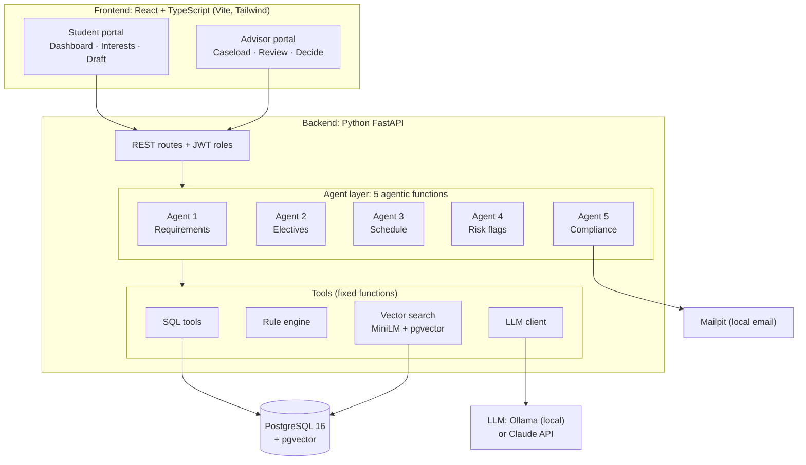
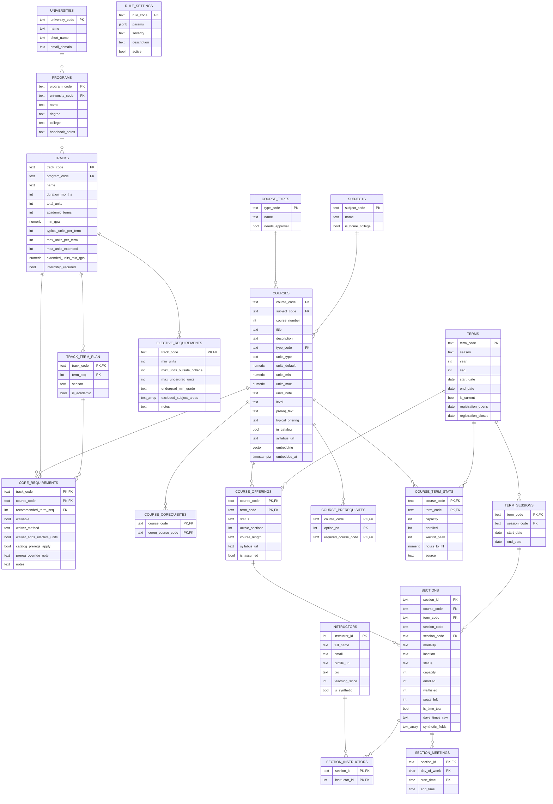
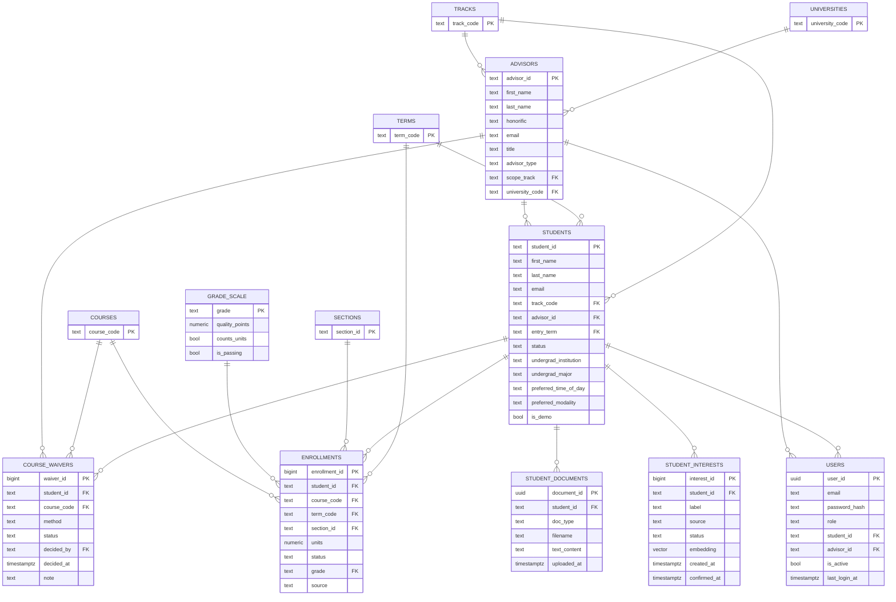
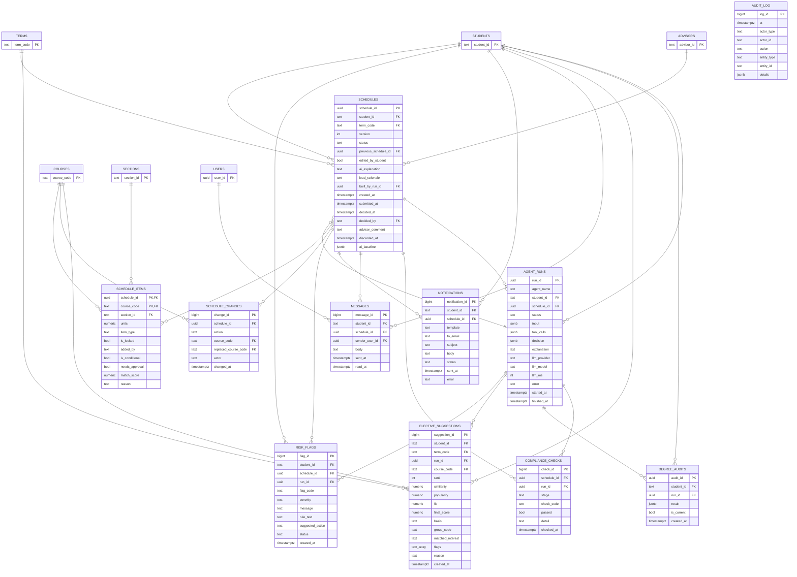

# Diagrams

Architecture and database diagrams for the Gray DI Degree Pathway Advisor. GitHub draws the diagrams below directly.
Database schema: PostgreSQL, schema `advisor` (see `db/schema.sql`).

## Architecture

How the browser, the API, the five agents, the tools and the database fit together.

## Database (1 of 3): programs, tracks and course catalog

Programs, tracks, the core plan, rule settings, terms, courses, offerings and sections.

## Database (2 of 3): people and academic record

Students, advisors, login users, enrollments, waivers, interests and uploaded documents.

## Database (3 of 3): schedules, agents and audit

Schedules and their items, agent runs, audits, flags, compliance checks, messages and notifications.

